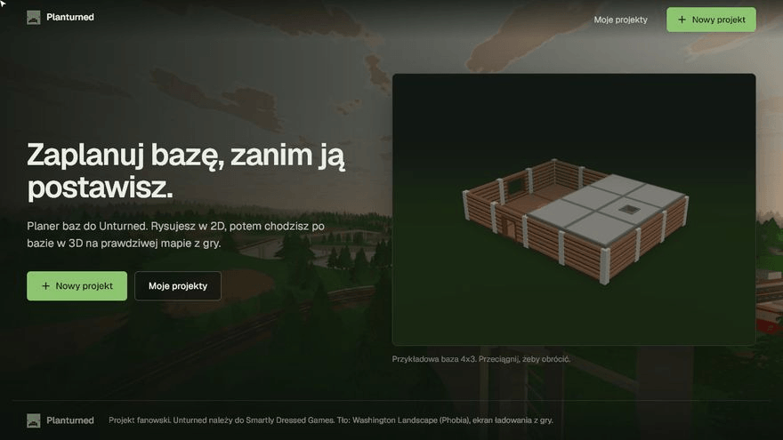

<p align="center">
  
</p>

<h1 align="center">Planturned</h1>

<p align="center">
  A base planner for <b>Unturned</b>. Draw your base in 2D, then walk through it in 3D on a real map from the game.
  <br>
  <a href="https://base-planner-unturned.vercel.app"><b>Open in the browser</b></a>
</p>

<p align="center"><b>English</b> · <a href="README.pl.md">Polski</a> · <a href="https://base-planner-unturned.vercel.app/changelog">Changelog</a></p>

<p align="center">
  
</p>

The recording is a real session in the app (with the Polish UI): a new project, 6 floors, walls with windows and a door, corner pillars, a roof over the ground floor, then the 3D view at day, dusk and night.

## Features

- **A 2D plan that works like the game.** Floors, walls, pillars, roofs, stairs and ramps in five materials (maple, birch, pine, metal, brick). Walls and pillars snap to edges and corners, and collisions show up right away.
- **Floors.** Up to four levels; the ones below show through as a backdrop.
- **3D view with an in-game camera.** Original structure models from the Unturned files. Fly or walk, place and demolish from the crosshair, change the time of day.
- **Real maps.** Russia, Washington, PEI, Germany, Yukon and more: terrain, satellite, buildings and trees at 1:1 scale. Skybases at any height.
- **Limits from the game.** Max build height, the oxygen line and no-build zones for each map ([docs/sky-limits.md](docs/sky-limits.md), in Polish).
- **Bed claim radius.** A circle shows where nobody outside your group can build.
- **No account.** Projects stay in your browser. Export a base to a `.baseplan.json` file and send it to your crew.
- **Custom keys.** Rebind toolbox pieces, demolish, bed, rotate, floors and 3D movement in the Keys tab.
- **English and Polish.** PL / EN switch in the menu and in the editor; without a choice the language follows your browser.

## Controls

Keys can be changed in the editor's **Keys** tab (saved in your browser). Defaults:

| Key | 2D plan | 3D view |
| --- | --- | --- |
| `1`-`9` | piece from the toolbox | piece from the toolbox |
| `X` / `B` | demolish / bed | demolish / bed |
| `R` | rotate | rotate |
| `LMB` | place, select, drag | place or demolish at the crosshair |
| `RMB`, wheel | pan, zoom | |
| `PgUp` / `PgDn` | floor up / down | |
| `Shift` + click | select several | |
| `Ctrl C` / `Ctrl V` | copy / paste (preview under the cursor) | |
| `Ctrl Z` / `Ctrl Y` | undo / redo | |
| `W A S D`, `Space`, `Q` | | move, up, down |
| `F` | | fly or walk |
| `Esc` | drop the piece | release the cursor |

## Tech

[Next.js 16](https://nextjs.org) (App Router), React 19, TypeScript, [three.js](https://threejs.org) with React Three Fiber and Drei, Zustand, Phosphor Icons. Hosted on [Vercel](https://vercel.com).

## Running locally

```bash
npm install
npm run export:game   # once: game data from your local install
npm run dev           # http://localhost:3000
```

The app works without the export too: structures are simple boxes and the Terrain tab shows instructions.

## Game data

`npm run export:game` runs `scripts/export_game_data.py`. The script finds Unturned in your Steam libraries on its own.
You can also pass the path: `python scripts/export_game_data.py "D:\Steam\steamapps\common\Unturned"`.

Requirements: Python 3.10+ and `pip install UnityPy numpy pillow`. Ground textures and roads only: `python scripts/export_game_data.py --terrain`.

What it writes (game files, for local use only, listed in `.gitignore`):

| Path | Source in the game |
| --- | --- |
| `public/game/structures.json` | 3D models, colors and health of structures (`Bundles/core.masterbundle`, `Bundles/Items/Structures/*.dat`) |
| `public/unturned/items/<id>.png` | icons from [SilKsPlugins/UnturnedImages](https://github.com/SilksPlugins/UnturnedImages) (vanilla folder); missing ones are generated from icons of the same shape |
| `public/maps/<Map>/height.bin` | terrain heights (`Maps/<Map>/Landscape/Heightmaps`, every 4 m) |
| `public/maps/<Map>/tiles/*.jpg` | in-game satellite (`Maps/<Map>/Map.png`) |
| `public/maps/<Map>/meta.json` | map size (`Level.dat`), water level (`Environment/Lighting.dat`), height limits and no-build zones (`Level.hierarchy`) |
| `public/maps/<Map>/scene.json` | buildings, objects and trees 1:1 (`Level/Objects.dat`, `Terrain/Trees.dat`) |
| `public/game/scenery/<guid>.json` | object and tree models (LOD0, palette colors) |
| `public/maps/<Map>/splat_N.png`, `public/game/terrain/*.png` | ground textures and their weights every 4 m (`Landscape/Splatmaps`, landscape materials in `Level.hierarchy`) |
| `public/maps/<Map>/roads.json`, `roads/*.png` | roads rebuilt from `Environment/Paths.dat`, `Roads.dat`, `Roads.unity3d` |

Sizes match the game models: floor 6 × 6 m, level 4.5 m, wall 5.6 × 4.25 m. In the plan, 1 m = 10 units.

## Structure

```
src/app/          pages: home, project list, editor /builder/[id]
src/components/   3D editor, map picker, terrain and objects
src/lib/          building logic, terrain, game models, projects, translations (i18n.ts)
src/store/        app state (Zustand)
scripts/          game data export
docs/             notes on game mechanics, demo recording
```

## Author

**tomson** ([@tomsoniik](https://github.com/tomsoniik), [debskitomal@gmail.com](mailto:debskitomal@gmail.com))

Unturned is a trademark of Smartly Dressed Games. Fan project, not affiliated with the game's developers. Game data is not part of this repository; the exceptions are the home page background in `public/art` (the in-game loading screen Washington Landscape by Phobia) and the zombie mark.
